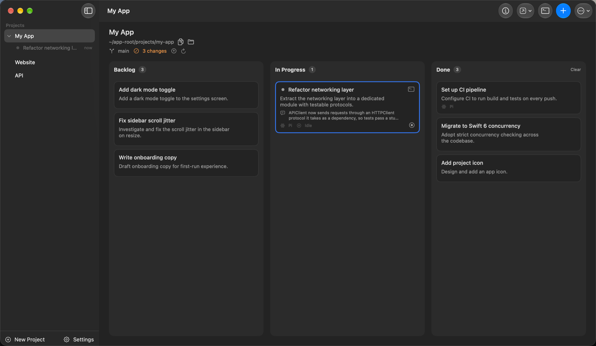
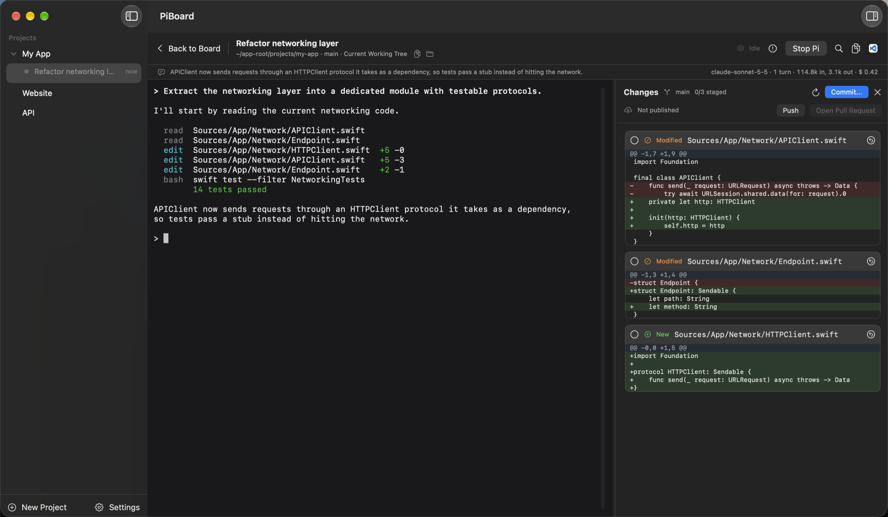
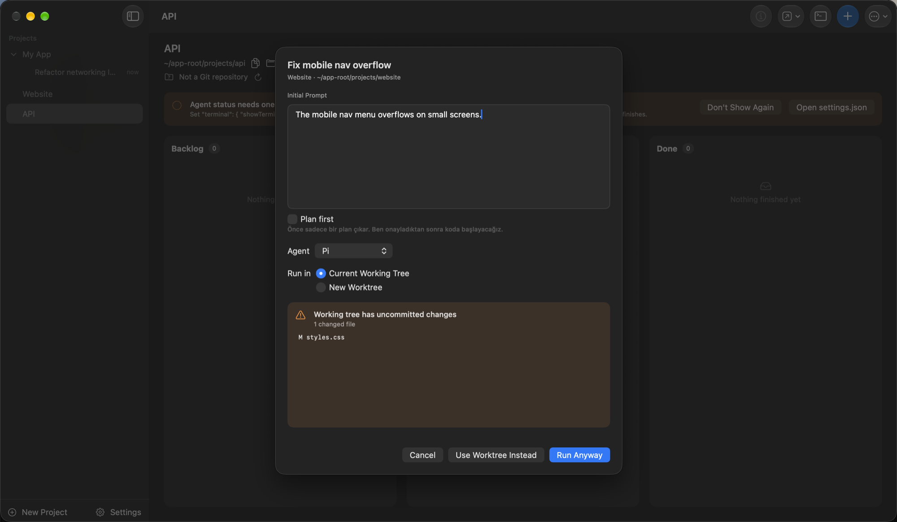

# PiBoard

PiBoard is a native macOS Kanban board for running coding agents on your local projects: the [Pi coding agent](https://github.com/earendil-works/pi), [OpenCode](https://opencode.ai) and [Claude Code](https://code.claude.com). Each project gets a board with Backlog, In Progress and Done. When you move a task to In Progress, you review its prompt, pick the agent, choose the current working tree or an isolated Git worktree, and start the agent in a real terminal embedded in the app, one terminal per task. PiBoard manages its own Pi install and a bundled Node runtime, and can set up the other agents for you with their official installers. It is for developers who already use these agents in a terminal and want several tasks per repository organized, resumable and kept apart.

## Screenshots



| | |
| --- | --- |
|  |  |
| Terminal: one session per task, your last message and usage above it, Changes panel on the right | Preparation: review the prompt, pick the agent and where it runs; a dirty tree offers a worktree instead |

The images come from `make screenshots`, which drives the app with demo data: [docs/development.md](docs/development.md#screenshots).

## Features

### Board

- Projects are local folders; each has its own board. Add by folder picker or by dropping a folder on the sidebar.
- Three columns with custom drag to reorder within and across columns; order is saved to SQLite in one transaction.
- Moving to In Progress opens a preparation sheet. It never starts Pi on its own.
- Done is always a manual move.
- Missing project folders get a banner with Locate Folder.
- The sidebar lists each project's running work: its In Progress tasks with a session appear under it, one line each, and a click opens that task's terminal. Click a project to see its board, click it again to fold its sessions. Drag projects to reorder them.
- The sidebar marks where to look with dots at the end of each row: green pulsing while an agent works, grey while an agent is alive but idle at its prompt, blue when an agent finished while you were elsewhere, orange when an agent waits for your answer (OpenCode permissions and questions, Claude Code permission prompts). The same dots appear on the task card; the blue one clears when you open that task's terminal or return to PiBoard with it open.
- Cards show the task's agent, a Working or Idle badge and the first line of the agent's last message. Task details show the session: turns, model, tokens, cost when the provider reports it, and the last message.
- Prompt templates: save snippets in Settings and insert them into a new task or the preparation sheet.
- The Done column has Clear, which deletes every Done task after a confirmation.

### Agents

- Pi, OpenCode and Claude Code. Each project has a default agent; the preparation sheet can override it per task. Pi is always available; turn OpenCode and Claude Code on or off in their Settings tab. A turned-off agent stays visible, greyed out, in the project and preparation pickers, and is left out of the commit agent choice and Migrate to.
- Pi runs from PiBoard's own install and uses `~/.pi/agent`, so sessions, extensions and logins carry over.
- OpenCode and Claude Code are installed by you or by PiBoard: when one is missing, its Settings tab offers Install, which runs the vendor's official installer in a terminal sheet after a confirmation. Update runs `opencode upgrade` or `claude update` in the same sheet. An Executable path field overrides auto-detection.
- Migrate to: a task with a stopped session can hand off to another agent, or to a fresh session of the same agent when the context is full. PiBoard writes an editable summary of the old session (task, prompt, last turns, changed files) as the new agent's first prompt. The old session stays on disk.

### Agent notifications

- When an agent finishes and PiBoard is not the frontmost app, a notification names the task and its project. Clicking it selects that project and task and opens its terminal.
- While PiBoard is frontmost, no notification is posted; only the dot appears.
- **Pi needs one setting.** For Pi tasks, PiBoard detects completion from the `OSC 9;4` progress sequences Pi writes to the terminal, and Pi only writes them when terminal progress is on. PiBoard does not edit your Pi settings, so set it yourself in `~/.pi/agent/settings.json`:

  ```json
  { "terminal": { "showTerminalProgress": true } }
  ```

  Without it the dots and notifications stay silent. The setting also makes Pi's progress bar visible in the terminal. PiBoard checks the file read-only and shows a banner on the board until the setting is on, or until you click Don't Show Again.
- OpenCode reports activity through its background service and Claude Code through its terminal title and hooks that PiBoard adds to its own launches only, so neither needs a setting.

### Sessions and terminal

- Real PTY terminal (SwiftTerm) per task; leaving the terminal does not stop the agent.
- Above the terminal, one line shows what you last asked (click it to jump to it in the terminal) with model, turns, tokens and cost, and the header has Copy Path, Finder and the repository's web page.
- Each task keeps one session id, written before launch; Resume reopens it, also after an app restart. Opening a task with a session resumes it automatically.
- Plan first: optionally appends a "plan before coding" instruction to the prompt.
- Stop with confirmation while the agent is working (SIGTERM, then SIGKILL after 5 s); an idle agent stops with one click from the card or the Stop Pi shortcut. Quitting the app asks before stopping running sessions or a running install.
- A project terminal drawer: a login shell in the project folder at the bottom of the board or a task's terminal.
- Command palette to jump to any project or task, and keyboard shortcuts you record yourself in Settings > Shortcuts (Toggle Terminal, New Task, Back to Board, Task Details, Toggle Changes Panel, Stop Pi, Command Palette, Copy Last Reply).
- Find in terminal, right-click Copy, Copy Reply Text, Copy Code and Paste, configurable font, line height, cursor, scrollback and Option as Meta. macOS editing keys work in the terminal: ⌥⌫ and ⌘⌫ delete a word or the line, ⌥← ⌥→ and ⌘← ⌘→ move by word or to the line ends, and characters your layout types with Option, such as `|` and `$`, are typed.

### Git and worktrees

- Preflight before every launch: shows the dirty file list and offers Use Worktree Instead or Run Anyway.
- One agent session per project's current working tree by default; a second one is blocked until you choose Start Anyway, which runs both agents on the same files.
- Optional managed worktree per task on branch `piboard/<id>-<slug>`, created from `HEAD`. Worktree tasks can run in parallel.
- Explicit Remove Worktree with a warning for uncommitted changes; the branch is always kept.
- Moving a worktree task to Done shows a reminder naming the branch and whether it has unpushed commits, with Remove Worktree... and Dismiss.
- The Changes panel next to the terminal commits with a message generated by Pi, OpenCode or Claude Code, without tools and without a saved session. Push and Open Pull Request are next to it. Setup details, such as the model and extension paths for Pi, are in the [User Guide](docs/user-guide.md#pi-runtime).

### Runtimes

- Bundled Node 24 inside the app; Pi is launched by absolute path, never from `PATH`.
- Pi is installed per version under Application Support with install, verify, activate, rollback and remove; a failed update keeps the active version.
- OpenCode and Claude Code are found at their usual install paths or on your shell `PATH`, with Install and Update in Settings.
- Your agent configuration is reused as is. PiBoard only deletes: removing a task removes the session it created (`~/.pi/agent/sessions`, `~/.claude/projects`, or through the OpenCode service).

### Portability

- Export a project and its tasks to `<name>.piboard.json`; import by menu or by dropping the file on the sidebar.
- Machine-specific data (session ids, worktrees) is not exported.
- Open In: VS Code, VSCodium, Cursor, Zed, Sublime Text, Kiro, the JetBrains IDEs (PhpStorm, IntelliJ IDEA, WebStorm, PyCharm, GoLand, RubyMine, CLion, Rider, RustRover), Android Studio, Terminal, iTerm, Warp or Finder, at the project or task working directory. The board has an Open In menu; the terminal header has a split button: click for the preferred editor, the arrow for every installed app.

### Updates

- Sparkle self-updates with EdDSA-signed releases.
- Stable or Beta channel, automatic checks, and PiBoard > Check for Updates...

## Requirements

- macOS 26 or later.
- An Apple Silicon (arm64) Mac; the bundled Node binary is arm64 only.
- A provider login for the agent you use: in `~/.pi/agent` for Pi, in OpenCode or Claude Code for those.
- Git, installed with the Xcode Command Line Tools (`xcode-select --install`).

No global Node or Pi install is needed. If you already use Pi, PiBoard reuses `~/.pi/agent` and only deletes the session files of tasks you delete.

## Install

1. Download the newest `PiBoard-<version>.zip` from [Releases](https://github.com/semiherdogan/piboard/releases). All releases so far are betas.
2. Unzip and move `PiBoard.app` to `/Applications`.
3. Open it. On first open, macOS shows "PiBoard Not Opened" because it cannot verify the app. Open System Settings > Privacy & Security, click Open Anyway next to the PiBoard message, and confirm. This happens because releases are ad-hoc signed without a paid Apple Developer account. It is needed once per install.
4. In Settings > Pi Runtime, click Install Latest to install Pi. For OpenCode or Claude Code, use Install in their Settings tab, or install them yourself.

### Updates

PiBoard checks `https://semiherdogan.github.io/piboard/appcast.xml` daily. Every update is verified against the EdDSA key built into the app, so updates install without Gatekeeper prompts.

- Settings > General > Updates: Check automatically, and Channel. Stable is the default; choose Beta to get beta builds.
- Check now: PiBoard > Check for Updates...

Pi is updated separately in Settings > Pi Runtime; OpenCode and Claude Code with Update in their Settings tab.

## Quick start

1. **Add a project.** Sidebar: New Project > New Project..., or drop a folder on the sidebar.
2. **Create a task.** New Task in the board header. Give it a title and a prompt.
3. **Move it to In Progress.** Drag the card. The preparation sheet opens.
4. **Prepare.** Edit the prompt, pick the agent, tick Plan first if you want a plan before code, and choose Current Working Tree (default) or New Worktree. Resolve any warning shown.
5. **Start.** The terminal workspace replaces the board, with the agent running in it.
6. **Work in the terminal.** Type to the agent directly. Back to Board keeps it running; double-click the card to return. Use Resume after the agent exits or after a restart.
7. **Move to Done yourself** when you are satisfied. PiBoard never does it for you.

Details: [User Guide](docs/user-guide.md).

## Development requirements

- Xcode 27.
- [xcodegen](https://github.com/yonaskolb/XcodeGen): `brew install xcodegen`.
- Metal Toolchain, downloaded once: `xcodebuild -downloadComponent MetalToolchain`. SwiftTerm contains a Metal shader.
- Node is not needed: `make generate` fetches it into `Runtime/node` automatically.

## Build from source

```sh
make generate         # fetch Node 24 into Runtime/node if missing, then xcodegen
make build            # Debug build into build/DerivedData
make test             # run PiBoardTests
make run              # build, quit a running PiBoard, open the Debug app
make screenshots      # regenerate the README images from demo data
make appicon          # regenerate the app icon from Design/appicon-1024-source.png
make release-dry-run  # ad-hoc signed 0.0.0 beta zip in build/release
make verify-bundle    # check the bundled node runs from the built app
```

`PiBoard.xcodeproj` is generated from `project.yml` and gitignored; do not edit it. Project layout, logging and running PiBoard's Pi from your own terminal: [Development](docs/development.md).

## Where data lives

PiBoard's own data is under `~/Library/Application Support/PiBoard/`:

| Path | Contents |
| --- | --- |
| `piboard.sqlite` | Projects, tasks, settings |
| `runtime/pi/versions/<version>/` | Installed Pi versions; `runtime/pi/current.json` points at the active one |
| `runtime/npm-cache/` | npm cache used for Pi installs |
| `worktrees/<project-id>/<task-id>/` | Managed Git worktrees |

Sessions stay where each agent keeps them: `~/.pi/agent/sessions/` for Pi, `~/.claude/projects/` for Claude Code, OpenCode's own database for OpenCode. Deleting a project or task in PiBoard deletes those tasks' sessions, after saying so in the confirmation. Repository files are never deleted; worktrees only when the confirmation lists them. Outside these folders PiBoard writes nothing.

## Documentation

- [Documentation index](docs/README.md)
- [User Guide](docs/user-guide.md)
- [Architecture](docs/architecture.md)
- [Development](docs/development.md)
- [Testing](docs/testing.md)
- [Releasing](docs/RELEASING.md)
- [V1 Spec](docs/spec.md) (Turkish, with deviations)

## License

MIT. See [LICENSE](LICENSE).
